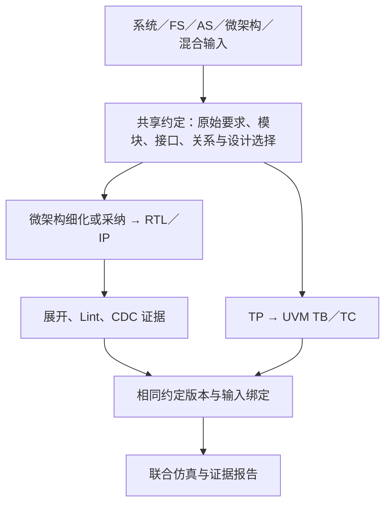

# 芯片设计、验证与 TRAE 中国版

此能力将大型规范、共享模块约定、RTL/IP、测试计划、UVM 生成任务和工具证据放入可恢复的项目状态。用户选定的 Agent runtime 提供模型和执行会话，LoopX 负责持久任务、产物校验、输入版本和执行证据。TRAE 中国版、Codex 等宿主可以通过同一能力推进两条工程线；两条线不要求两个 Agent。它是 LoopX 的增量能力，不需要另建仓库，也不需要用户手动编辑任务状态 JSON。

状态阶段、LoopX 权责边界和 UVM 组件划分见 [状态与 UVM 方法](docs/state-and-uvm.md)。当前入口支持从不同规格层级生成共享约定，分别推进设计与 DV，并在检查和输入一致性验证后汇合。通用 regression/覆盖率闭环尚未公开；大模块分片的自动集成仍待实现，不能将分片生成或 smoke 成功报告为整芯片覆盖率验收完成。

## 安装到芯片项目

本次增量是源码／本地 wheel 预览，尚未作为 PyPI 发布版本交付。准备 Python 3.11+ 与 Node.js 22.22.3+，在当前 LoopX 仓库根目录安装：

```powershell
python -m pip install ".[chip-verification]"
```

也可安装本次交付提供的本地 wheel 及 `chip-verification` 可选依赖；开发环境可用 `uv sync --extra test --extra chip-verification`。然后在相同环境运行：

```powershell
python -m loopx.cli chip-verification --workspace D:\chips\customer-project install-trae
python -m loopx.cli chip-verification --workspace D:\chips\customer-project install-trae --execute
```

第一次只预览，第二次安装。也可直接使用模块入口：

```powershell
python -m loopx.capabilities.chip_verification.integration --workspace D:\chips\customer-project --execute
```

安装器合并 `.trae/mcp.json` 并生成 `.trae/skills/loopx-dv/SKILL.md`、`.trae/agents/loopx-dv-worker.md`、短入口规则和 `/loopx-dv` 命令。已有其他 MCP、规则与 Skill 保持原样；同名用户配置或修改过的受管理文件会得到明确冲突信息，安装器不会覆盖它们。安装目录中的 sidecar 仅记录文件归属，不承担 DV 状态管理。

在 TRAE 中国版打开该芯片项目，执行以下配置：

1. 设置 → MCP：启用项目级 MCP，确认 `loopx-dv` 服务和工具已加载。
2. 使用内置 **Agent**，开启新对话，输入：`用 loopx-dv 从 spec.json 推进芯片设计和 UVM 验证。先读取状态，每次只处理一个有界任务；按真实工具证据报告结果和未完成项。`
3. 若希望使用宿主原生子会话隔离上下文，可启用 Subagents 并使用随附的 `loopx-dv-worker`；这是可选执行方式。

官方确认了项目 MCP、按需 Skill、文件化子智能体的目录与加载机制。子智能体拥有独立上下文，只有内置 Agent 能调用。[MCP 配置](https://docs.trae.cn/ide_add-mcp-servers)、[Skill](https://docs.trae.cn/ide_skills)、[Subagent](https://docs.trae.cn/ide_subagents)、[规则](https://docs.trae.cn/ide_rules)

安装结果 `host_verified: false` 是有意保留的边界：文件安装和协议测试不能替代用户设备上的 TRAE 加载与模型行为实测。首次使用请确认工具调用和任务提交回执；采用可选子会话时，再检查实际委派记录。

## 从大规范到验证证据

Agent 以文件路径调用 `dv_import`，默认 `flow="design-dv"`。规范由服务本地解析，模型不接收整份文件。输入可以是产品/系统需求、FS、AS、微架构、接口规格，或混合内容；已有微架构可以直接采纳，不要求补写缺失的 FS/AS。输入层级不代表信息完整：影响实现或判定正确性的具体歧义仍会阻塞相应工作。

`dv_next` 返回下一项工作摘要；当前会话或可选 worker 用 `dv_claim` 取得 attempt，再用 `dv_context` 取得当前模块、功能、关系或工程步骤所需的完整材料和响应 schema。分片由规格结构与工作对象决定，没有固定字符数或 token 数门槛；长度仅用于观察，不触发切分、截断或阻塞。生成响应后调用 `dv_submit`，服务校验通过才推进任务。耗时工作可 `dv_heartbeat` 续约，失败用 `dv_abandon` 写明原因。重新打开对话或重启 MCP 后从 `dv_status` 恢复；宿主按需更换会话，避免把全部任务材料累积进同一次对话。

对于显式的 `dvflow.spec_bundle`，可把规格修订或范围约定保存为独立 `specification` 文档，其 `origin.kind="source_adjudication"`、`authored=true`，并提供正文 SHA-256 和 `targets`（目标 `document_id`、完整原文 SHA-256、从 1 开始且两端包含的 `line_start/line_end`）。导入会验证目标、行范围和无环依赖；普通文档关系不赋予覆盖优先权，也不能用修订将 `reference` 变成规范。受影响分片必须携带完整相关规则并共同引用，缓存标签与原始输入不一致时拒绝继续；依赖材料不会因长度被省略。正文中的题设决定仍需模型按条件理解，来源校验不是语义正确性证明。[公开题库](../../../examples/chip-verification/README.md) 展示了此格式。

源需求抽取完成后，服务按模块和功能相关需求准备共享约定任务。约定保留规范来源、模块身份、接口、时钟复位、配置和跨模块关系，并区分原始要求与设计选择。两条线绑定同一个约定任务及摘要：设计线生成微架构、RTL 或已有本地 IP 的固定版本绑定；DV 线生成 TP，再按 UVM 生成 TB/TC。DV 的预期行为来自源规格，生成 RTL 的行为不能成为独立检查依据。

系统／FS 输入尚未划分模块时，控制面先保留一个范围根节点，允许在共享约定中提出有来源依据的子模块和关系。新模块必须标记为 `design_choice`，使用稳定的限定名称与身份，并声明所属父节点及依据的原始要求；两条线读取同一组选择。已有微架构可直接沿用，不强制重新建立架构树。如果输入只有环境说明而没有可实现或可验证的要求，状态会明确显示 `insufficient_behavior`，不会把空 TP 报告为完成。



需求按已声明的模块、功能、接口及跨模块关系组织；微架构、RTL、测试计划和 UVM 组件沿各自工程步骤处理。结构化规格按对象和章节保留完整语义，无结构的长段落保持完整，不按长度猜测切点。每个范围保留同一个模块身份、明确的分工和集成义务；不能把一个局部 RTL 候选当作完整模块。当前自动模块集成尚未实现，`composition_required` 的候选会在联合仿真入口明确阻塞。

旧版 `chunk_chars`、`context_chars` 参数仅为调用兼容保留，不再控制切分或任务准入。旧工作区通过正常 `import` 迁移到结构分片，历史记录保留，旧分解的派生工作失效后按新任务继续；只读状态会提示是否需要迁移。宿主自身的模型容量仍由宿主管理，工具失败应记录具体错误，不能用字符阈值替代工程分工。

| 工具 | 用途 |
|---|---|
| `dv_engineering_status` | 读取输入视图、共享约定、两条线状态及待集成义务 |
| `dv_prepare_design` | 为既有 DV 项目启用共享约定及设计线 |
| `dv_design_map` | 读取文档与层级投影；该投影本身不等于已接受的设计约定 |
| `dv_generation_scopes` | 读取已有 TP 的 UVM 生成范围 |
| `dv_generate_uvm` | 用 `contract_task_id` 与 `top` 从共享接口生成 UVM，允许 RTL 尚未存在 |
| `dv_check_design` | 对已接受 RTL 候选启动后台静态检查，返回作业回执 |
| `dv_join_design` | 将相同约定下的 RTL、UVM 文件和有效静态检查绑定为仿真清单 |

`dv_generate_uvm` 可能直接返回已领取的 attempt，此时读取该 attempt 的上下文，无需再次 claim。生成内容需满足 transaction、sequence、driver、monitor、scoreboard、coverage、env、test 与顶层的约定一致性。已有 RTL 的兼容路径可显式使用 `dv_import(..., flow="dv")`，再提供 RTL 文件、顶层和可选 profile。

静态检查分别记录 Vivado 综合/展开、Verible 语法与风格检查、受约束设计上的结构性 CDC。Vivado 使用记录在证据中的 FPGA 检查目标；结果不等于 ASIC signoff、完整 RTL 语义 lint、RDC 或功能正确性。缺失工具、时钟约束或无法识别的报告都保留为未通过的检查。可通过 `XILINX_VIVADO` 指定 Vivado 安装目录，通过 `LOOPX_VERIBLE_LINT` 指定 Verible 可执行文件。

规格未给出时钟目标时，可以保留未知值并报告检查缺口，也可以提出明确的实现／测试时钟选择。后者必须标记 `design_choice`，附原始要求引用、选择理由和 `performance_guarantee=false`；它不能覆盖已给定的时钟周期，也不能替代仍未明确的规范性延迟或吞吐要求。

在安装 TRAE 接入前设置这两个环境变量，安装器会将明确的工具位置保留在项目 MCP 配置中，供重启后的后台工具进程使用。工具迁移后重新安装接入配置；`dv_doctor` 可读取当前绑定。

设计路径先执行 `dv_join_design`，再把返回的清单交给 `dv_build_uvm`。参数化实例配置的联合验证目前未完成资格验证，会明确拒绝。`dv_build_uvm` 提交后台 EDA 作业，默认使用 Vivado 并执行 smoke；通过 `dv_job_status` 读取检查或仿真进度。`dv_report` 报告真实证据和限制；通用覆盖率目前未知，不能用任务完成率充当覆盖率。

## 会话与能力边界

外部工具现在可通过持久事件入口报告状态；独立 Watchdog 检查健康、重复失败和工程进展，形成受版本约束的审查与恢复闭环。操作、事件合同、独立会话桥接及尚未验证的 EDA 边界见 [事件与 Watchdog](docs/events-and-watchdog.md)。原有本机 Vivado 作业仍使用 `dv_job_status`，不会自动变成远程 Cadence 作业。

已接受的 RTL 或 UVM 组件在检查中失败时，用 `dv_revise(task_id, reason)` 记录诊断并重新领取；旧检查、构建和下游产物会失效。`dv_retry` 对工具任务返回相应的检查／构建操作，不会将其误排为模型任务。修正仍受原规格和共享约定约束，不能降低要求换取通过。

会话保留当前任务所需的上下文，交接只需目标、任务摘要和产物引用。`session_id` 是调用方提供的执行标签，`attempt_id` 是服务持久化的提交凭据；它们不声称是经 TRAE API 认证的原生会话身份。状态恢复不依赖之前的聊天记录。协议可验证恢复和过期提交拒绝；是否创建新会话及其上下文隔离效果仍由所选宿主负责。

可以在内置 Agent 使用原生 `/goal` 继续推进长任务；本适配不调用外部会话派发 API，不创建隐藏 heartbeat。它专门面向 TRAE 中国版 IDE，与 LoopX 已有 TraeX 入口分开。官方 CLI 2.0 支持 `traecli exec`/ACP，但限定企业旗舰套餐、需要单独登录；普通 IDE 登录并不自动等于 CLI/API 授权。[Goal 工作流](https://docs.trae.cn/ide_built-in-workflows)、[CLI 使用限制](https://docs.trae.cn/cli_about-trae-code-cli-2)

## 验证与排错

`dv_doctor` 检查 provider 和 EDA 环境。MCP 启动失败时检查安装时的 Python 环境是否仍然存在、是否安装 MCP，以及工作区路径。安装器将执行程序与参数分开；带空格的解释器目录通过显式 PATH 解析，工作区通过 `${workspaceFolder}` 传入。MCP 继承安装时写入的 PATH；先用 `node --version` 确认当前解析到的是 Node.js 22.22.3+，再安装。系统存在多个 Node 时将合格版本的目录放在当前终端 PATH 前面即可，不必修改机器全局配置。依赖环境迁移后重新运行安装；若用户修改过配置，先按冲突提示处理。

自动测试覆盖真实 stdio 的初始化与工具调用、跨连接持久状态、无效参数拒绝，以及安装预览、重复安装、保留用户配置和失败回滚。它们验证本地接入层，不能证明任意芯片设计已达到某一覆盖率，也不能替代 TRAE 实机行为检查。
