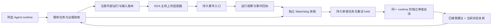

# External events and Watchdog / 外部事件与 Watchdog

LoopX keeps chip tasks, accepted evidence, tool observations and recovery decisions
in the existing chip project's SQLite store. A worker session can end while an
EDA run or Watchdog continues. The design and DV tracks still share the same
specification and interface contracts. No second Goal owner or required model
backend is introduced.

目标是减少反复查询、日志搬运和无效重试。Skills 保留 UVM/设计方法与操作指导；
事件入口负责可靠交接；Watchdog 负责检查进展并限制重复执行。用户不需要维护
状态 JSON，下面的事件对象是工具适配器协议。



## Event contract

Use `dv_register_run` / `loopx chip-verification run-register --execute` before
dispatching work on the tool host. Required registration fields are `run_id`,
`task_id`, `tool`, `source` and a SHA-256 `input_digest`. Optional `attempt_id`
binds a live attempt at registration. Separate queue, heartbeat and total-run
budgets allow long formal runs and license queues to be configured explicitly.
Registration records the current baseline and task revision; it never starts EDA.
The adapter must calculate the digest over the actual pinned inputs, including
the RTL/TB, shared contract, constraints, configuration, tool version and seeds
where applicable. The core stores this assertion; it does not remotely verify
those files.

Example event for a registered run (replace the baseline with the registration
receipt's `run.baseline_id`):

```json
{
  "id": "compile-001-failure",
  "source": "eda-lab-adapter",
  "run_id": "compile-001",
  "baseline_id": "baseline-from-registration",
  "sequence": 2,
  "type": "failed",
  "data": {
    "failure_signature": "reset-domain:unconstrained-crossing",
    "message": "Review reset constraints before another equivalent run.",
    "evidence": [{"uri": "eda://compile-001/diagnostics", "sha256": "aaaaaaaaaaaaaaaaaaaaaaaaaaaaaaaaaaaaaaaaaaaaaaaaaaaaaaaaaaaaaaaa"}]
  }
}
```

Send with `dv_ingest_event(event)` or `event-ingest --event-file event.json
--execute`. The CLI file must be inside the selected workspace and at most
64 KiB. The core never downloads the evidence URI or executes text from events.

| Event | Meaning |
|---|---|
| `started` | Adapter observed the tool start |
| `heartbeat` | Adapter observed liveness; not engineering progress |
| `progress` | Bounded claimed metrics; not accepted coverage |
| `evidence` | Artifact references became available |
| `completed` | Tool reports completion; evidence validation remains separate |
| `failed` | Failure with a bounded stable signature |
| `cancelled` | Adapter observed cancellation, not merely a cancellation request |

Deliver at least once: retain the same `source` + `id` and identical content on
retry. Conflicting reuse is rejected. The inbox receipt and observed run update
commit in one transaction. Old-baseline, superseded-attempt and out-of-order
events are retained without regressing the current run. Terminal arrival does
not require delivery of an earlier start event. Evidence may arrive after the
terminal event, or arrive before it through network reordering; evidence and
heartbeat sequence numbers cannot suppress a valid completion. Observation times
come from the receiver.

`dv_event_status(after=cursor, limit=50)` reads bounded receipts across sessions.
The consumer retains its cursor. There is no exactly-once remote tool execution,
network transport or authenticated source identity implied by this API. Run IDs
must also be used as idempotency keys in the tool-host dispatch layer. Uncertain
dispatch must be reconciled on that host before resubmission.

Large event bodies stay in the inbox. `dv_event_read(cursor, offset, limit)`
recalls exact text slices (default 8,000, maximum 16,000 characters), with the
immutable payload hash and next offset. Summary polling never replays every log
into the model context.

## Independent control loop

Start one explicit process per workspace, outside the worker/MCP process:

```console
python -m loopx.capabilities.chip_verification.watchdog_service --workspace /path/to/chip --execute --once
python -m loopx.capabilities.chip_verification.watchdog_service --workspace /path/to/chip --execute --interval 30
```

Use an operating-system service supervisor to restart this process after a
machine restart. It is not itself an OS availability guarantee. Stop the service
to stop periodic ticks; persistent incidents and task evidence remain intact.
`dv_watchdog_tick` performs the same control pass explicitly.

The control loop distinguishes:

- Infrastructure symptoms: expired worker leases, missing tool heartbeats,
  queue/run deadlines. A missed heartbeat is not proof that EDA died; it does
  not authorize killing or resubmitting the external run.
- Engineering symptoms: consecutive equivalent failures and lack of accepted
  task/artifact progress. Heartbeats, claimed coverage, repeated text and the
  Watchdog's own review activity do not count as design/DV progress.
- Semantic judgment: a bounded immutable snapshot gives an independent session
  the task goal, evidence references, recent failures and previous strategy.
  The model assesses direction and proposes a different concrete strategy or
  a delayed recheck. A policy can trigger this review even if a worker remains
  alive.

Repeated failure places a durable hold on new claims/retries/run registrations
for the affected task. Existing evidence is preserved. Claim the review with
`dv_claim(kind="watchdog-review", session_id="fresh-review-session")`, read
`dv_context`, then submit the schema it supplies. A review is excluded from
ordinary worker claims. Labels used by the reviewed workers are rejected;
the runtime must actually create a fresh session because a supplied label is
not proof of native host isolation.

`dv_watchdog_apply(review_task_id=...)` (also reconciled by subsequent ticks)
requires an accepted review and checks the current baseline, target revision,
attempt and evidence again. A stale suggestion cannot act on newer work.
Resumption requires a different strategy and consumes a bounded recovery budget.
A wait schedules a recheck and preserves the hold. This does not rewrite FS/AS,
change acceptance criteria, approve a waiver or grant arbitrary shell access.
`dv_watchdog_policy(policy, reason)` versions validated thresholds and records
why they changed. Review/apply actions and policy versions are queryable after
restarting the Agent.

New unverified telemetry invalidates an old review and refreshes its snapshot
while preserving the hold. Only trusted engineering progress or retirement of
the affected work can release it without a fresh accepted recovery decision.
Accepted recovery advice is included in the next worker context, so the next
attempt actually receives the changed strategy. An earlier accepted review
cannot take ownership back from a newer review generation.

The optional `--review-command` service bridge runs an explicitly configured
program without a shell. It receives one bounded request on stdin and returns
one JSON response on stdout. Use it to connect the selected runtime's supported
fresh-session interface. Without a bridge, reviews remain ready until a runtime
claims them; MCP tool availability alone cannot wake a closed Trae/Codex UI.
Bridge launch retries and execution time are bounded, separately from EDA runs.
See the service's `--help` for its transport and process limits.

The bridge receives `{protocol, workspace, task_id, attempt_id, session_id,
context}` on stdin; it must wait for a fresh model session and return just the
review JSON on stdout. It must not detach the model invocation or submit/apply
the result itself. The service supervises its directly owned bridge process.
An interrupted launch with unknown outcome stays `uncertain` for inspection
through `dv_watchdog_status` and a manual independent session; it is not blindly
launched again. Malformed responses and ordinary command failures get at most
three attempts for that review with persisted backoff.

## EDA boundary and validation

The event protocol is tool-neutral. A future Cadence-host adapter can map
Xcelium compile/elaborate/simulation, Jasper lint/CDC/formal, and vManager
regression/evidence updates into these observations. Cadence documents separate
verification and metric-management roles; they should retain their native
reports and metric denominators. See [Cadence's metric-driven signoff overview](https://community.cadence.com/cadence_blogs_8/b/breakfast-bytes/posts/metric-driven-signoff)
and [Cadence's Jasper static verification overview](https://community.cadence.com/cadence_blogs_8/b/cadence-support/posts/jasper-static-comprehensive-signoff-for-rtl-designers).

This increment supplies no Cadence command templates, license integration,
report parser, remote launcher or coverage qualification. The existing local
Vivado path remains available separately. An event reporting 95% coverage or
successful termination cannot set `signoff` or complete an engineering task;
the existing domain validators must qualify actual matching evidence. Neither
functional coverage nor code coverage is measured by the offline event tests.

The core tests cover duplicate/conflicting delivery, reordering, stale versions,
atomic recovery, review holds, changed evidence, bounded recovery, independent
process restart and bridge errors. Synthetic emitters and bridge fixtures prove
transport/control behavior, not a model's engineering competence or EDA results.

## Design references

The supplied “Super-agent 设计探索” article motivates separating state from
execution and monitoring meaningful task progress with an external loop. The
implementation also draws on these primary references, without taking a runtime
dependency on any of them:

- [CloudEvents event identity](https://github.com/cloudevents/spec/blob/main/cloudevents/spec.md):
  stable producer/event identity for duplicate delivery. This local envelope is
  inspired by that rule and is not advertised as CloudEvents conformance.
- [Temporal activity semantics](https://github.com/temporalio/documentation/blob/main/docs/encyclopedia/activities/activity-definition.mdx):
  retries require stable operation identity, heartbeats and explicit deadlines;
  timeout does not establish that an external side effect never happened.
- [Kubernetes controllers](https://kubernetes.io/docs/concepts/architecture/controller/):
  periodically reconcile observations with intended state, rather than rely on
  one long-lived conversation remembering every step.

Placement: `watchdog-review` extends the existing chip task stages. Event types,
Watchdog policy and new actions remain capability-local vocabulary. TypeScript
owns admission and recovery decisions; Python handles domain observation,
SQLite transactions and process transport. They do not add a generic scheduler
or reuse a same-named value from an unrelated Goal/settlement state machine.
